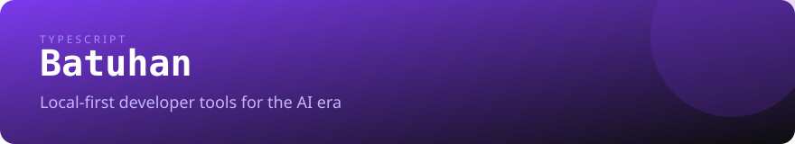
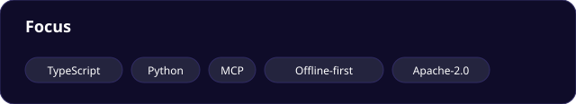
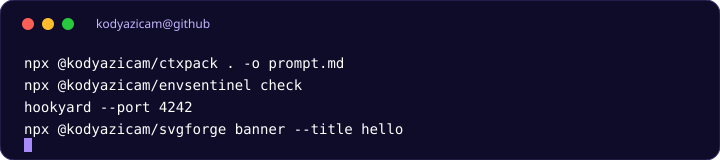
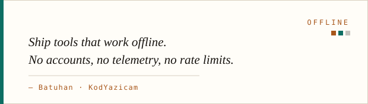

  
  

# Hi, I'm Batuhan

I build **local-first developer tools** for the AI era: CLIs and MCP servers that keep source code, secrets, and webhooks on your machine.

I care about tools that are **small, offline by default, secure by design, and documented like products** — not demos.

**English** · [Türkçe](./README.tr.md) · [Website](https://kodyazicam.github.io/KodYazicam/)

[Flagship tools](#flagship-tools) · [Why local-first](#why-local-first) · [Also building](#also-building) · [Toolbox](#toolbox) · [How I work](#how-i-work) · [Contact](#contact)

---

## Flagship tools

| Project | What it does | Install |
| --- | --- | --- |
| **[ctxpack](https://github.com/KodYazicam/ctxpack)** | Packs a repository into an LLM-ready prompt. Respects `.gitignore`, budgets tokens, redacts secrets. Ships an MCP server. | `npm i -g @kodyazicam/ctxpack` |
| **[envsentinel](https://github.com/KodYazicam/envsentinel)** | Validates `.env` against a JSON schema, scans for leaked secrets, and generates `.env.example` plus TypeScript types. | `npm i -g @kodyazicam/envsentinel` |
| **[svgforge](https://github.com/KodYazicam/svgforge)** | Generates README banners, cards, and stats as committed SVG files. 32 card types, 22 themes, no render service. | `npm i -g @kodyazicam/svgforge` |
| **[hookyard](https://github.com/KodYazicam/hookyard)** | Inspects, verifies, and replays webhooks locally. GitHub, Stripe, Slack, and Discord signatures; SSRF-safe replay. | [Source install](https://github.com/KodYazicam/hookyard#install) |

All four are **Apache-2.0**, **offline-first**, and **scriptable**. `ctxpack`, `envsentinel`, and `hookyard` also expose MCP servers for AI agents.

> **In progress:** a single `kodyaz` entry point that exposes the suite as one CLI and one MCP server. See the [suite architecture](./docs/SUITE.md).

  

---

## Why local-first?

- **Your code stays yours.** No upload, no account, no telemetry.
- **Works when the network does not.** Air-gapped machines, CI runners, locked-down laptops.
- **Composable by design.** Plain files in, plain files out. Every tool is scriptable.
- **Agent-ready.** MCP lets Claude, Cursor, and other clients call the tools directly.

---

## Also building

| Project | Status | What it is |
| --- | --- | --- |
| **[sparkcord](https://github.com/KodYazicam/sparkcord)** | beta | File-based Discord.js v14 framework with slash + prefix commands, cooldowns, permissions, and a validator. |
| **[LogYazicam](https://github.com/KodYazicam/LogYazicam)** | stable | Self-hosted Discord logging bot with per-guild routing, filters, and 60 event keys. |
| **[discord-music-panel](https://github.com/KodYazicam/discord-music-panel)** | stable | Self-hosted multi-bot Discord music panel with a React dashboard. |
| **[awesome-developer-portfolios](https://github.com/KodYazicam/awesome-developer-portfolios)** | community | Curated list of developer portfolios. MIT, contributions welcome. |

---

## Toolbox

- **Languages:** TypeScript · JavaScript · Python · SQL
- **Backend:** Node.js · FastAPI · SQLite · REST · WebSockets
- **Frontend:** React · Tailwind CSS · PySide6
- **Tooling:** Docker · GitHub Actions · pytest · Vitest · Linux

Currently deepening: PostgreSQL, Redis, and production observability.

---

## How I work

- **Docs are part of the product.** Every repo ships install steps, examples, limits, and troubleshooting.
- **Security is a feature.** Secret redaction, HMAC verification, SSRF guards, and local-only defaults.
- **Small surfaces.** Prefer one sharp CLI over a platform that does everything.
- **No fake metrics.** If something is not published, the README says so.
- **Responsible automation.** Read the [policy](./ETHICS.md).

  

---

## Contributing

The fastest way in is a `good first issue`:

- [ctxpack](https://github.com/KodYazicam/ctxpack/issues?q=is%3Aissue+is%3Aopen+label%3A%22good+first+issue%22)
- [envsentinel](https://github.com/KodYazicam/envsentinel/issues?q=is%3Aissue+is%3Aopen+label%3A%22good+first+issue%22)
- [svgforge](https://github.com/KodYazicam/svgforge/issues?q=is%3Aissue+is%3Aopen+label%3A%22good+first+issue%22)
- [sparkcord](https://github.com/KodYazicam/sparkcord/issues?q=is%3Aissue+is%3Aopen+label%3A%22good+first+issue%22)

## Contact

- Open an issue or discussion in the relevant repository.
- For security reports, use the `SECURITY.md` in that repository.
- GitHub: [@KodYazicam](https://github.com/KodYazicam)
- Website: [kodyazicam.github.io/KodYazicam](https://kodyazicam.github.io/KodYazicam/)

Profile assets are generated locally with <a href="https://github.com/KodYazicam/svgforge">svgforge</a>.
