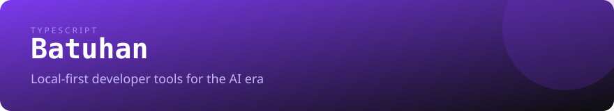

  

# Merhaba, ben Batuhan

Yapay zeka çağı için **local-first geliştirici araçları** yazıyorum: kaynak kodun, secret'ların ve webhook'ların makinenin dışına çıkmayan CLI'lar ve MCP sunucuları.

Önem verdiğim şey **küçük, varsayılan olarak çevrimdışı çalışan, güvenli ve ürün gibi dokümante edilmiş** araçlar — demo değil.

[English](./README.md) · **Türkçe** · [Website](https://kodyazicam.github.io/KodYazicam/)

[Öne çıkan araçlar](#öne-çıkan-araçlar) · [Neden local-first?](#neden-local-first) · [Diğer projeler](#diğer-projeler) · [Araç kutusu](#araç-kutusu) · [Nasıl çalışıyorum](#nasıl-çalışıyorum) · [İletişim](#i̇letişim)

---

## Öne çıkan araçlar

| Proje | Ne yapar? | Kurulum |
| --- | --- | --- |
| **[ctxpack](https://github.com/KodYazicam/ctxpack)** | Bir repoyu LLM'e hazır prompt'a paketler. `.gitignore`'a uyar, token bütçesi koyar, secret'ları redakte eder. MCP sunucusu içerir. | `npm i -g @kodyazicam/ctxpack` |
| **[envsentinel](https://github.com/KodYazicam/envsentinel)** | `.env` dosyasını JSON şemasına göre doğrular, sızan secret'ları tarar, `.env.example` ve TypeScript tipleri üretir. | `npm i -g @kodyazicam/envsentinel` |
| **[svgforge](https://github.com/KodYazicam/svgforge)** | README banner, kart ve istatistiklerini commit edilen SVG dosyaları olarak üretir. 32 kart tipi, 22 tema, render servisi yok. | `npm i -g @kodyazicam/svgforge` |
| **[hookyard](https://github.com/KodYazicam/hookyard)** | Webhook'ları yerelde inceler, doğrular ve yeniden oynatır. GitHub, Stripe, Slack ve Discord imzaları; SSRF-safe replay. | [Kaynaktan kurulum](https://github.com/KodYazicam/hookyard#install) |

Dördü de **Apache-2.0**, **offline-first** ve **scriptable**. `ctxpack`, `envsentinel` ve `hookyard` ayrıca AI ajanları için MCP sunucusu sunar.

> **Üzerinde çalışıyorum:** Tüm araçları tek bir CLI ve tek bir MCP sunucusu olarak açan `kodyaz` giriş noktası. [Suite mimarisi](./docs/SUITE.md).

---

## Neden local-first?

- **Kodun sende kalır.** Upload yok, hesap yok, telemetri yok.
- **Ağ yokken de çalışır.** Air-gapped makineler, CI runner'ları, kısıtlı laptoplar.
- **Tasarımı gereği birleştirilebilir.** Girdi dosya, çıktı dosya. Her araç script'lenebilir.
- **Ajanlara hazır.** MCP sayesinde Claude, Cursor ve diğer istemciler araçları doğrudan çağırabilir.

---

## Diğer projeler

| Proje | Durum | Ne yapar? |
| --- | --- | --- |
| **[sparkcord](https://github.com/KodYazicam/sparkcord)** | beta | Dosya tabanlı Discord.js v14 framework'ü: slash + prefix komutlar, cooldown, yetki ve validator. |
| **[LogYazicam](https://github.com/KodYazicam/LogYazicam)** | stable | Sunucu bazlı yönlendirme, filtreler ve 60 event anahtarı olan self-hosted Discord log botu. |
| **[discord-music-panel](https://github.com/KodYazicam/discord-music-panel)** | stable | React paneli olan self-hosted çoklu bot Discord müzik paneli. |
| **[awesome-developer-portfolios](https://github.com/KodYazicam/awesome-developer-portfolios)** | community | Derlenmiş developer portfolyo listesi. MIT, katkıya açık. |

---

## Araç kutusu

- **Diller:** TypeScript · JavaScript · Python · SQL
- **Backend:** Node.js · FastAPI · SQLite · REST · WebSockets
- **Frontend:** React · Tailwind CSS · PySide6
- **Araçlar:** Docker · GitHub Actions · pytest · Vitest · Linux

Şu anda derinleştiğim alanlar: PostgreSQL, Redis ve production observability.

---

## Nasıl çalışıyorum

- **Dokümantasyon ürünün parçasıdır.** Her repoda kurulum, örnek, limit ve troubleshooting var.
- **Güvenlik bir özelliktir.** Secret redaksiyonu, HMAC doğrulama, SSRF koruması ve local-only varsayılanlar.
- **Küçük yüzey.** Her şeyi yapan bir platform yerine tek ve keskin bir CLI.
- **Sahte metrik yok.** Bir şey yayınlanmadıysa README bunu açıkça söyler.
- **Sorumlu otomasyon.** [Politikayı oku](./ETHICS.md).

---

## İletişim

- İlgili repoda issue veya discussion açabilirsin.
- Güvenlik bildirimleri için o repodaki `SECURITY.md` dosyasını kullan.
- GitHub: [@KodYazicam](https://github.com/KodYazicam)
- Website: [kodyazicam.github.io/KodYazicam](https://kodyazicam.github.io/KodYazicam/)

Profil görselleri <a href="https://github.com/KodYazicam/svgforge">svgforge</a> ile yerelde üretilir.
